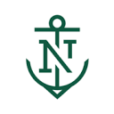

<h1 align="center">Hi, I'm Jaime Calahorrano 👋</h1>

  <b>Systems engineer · 24 years shipping software · Rust & C++ for low-latency, distributed systems</b> 
  📍 Chicago

  
  

---

### 🦀 What I build

I build the core of trading and real-time data systems, the parts that have to be fast, correct and
always up. That means market data servers that fan out prices to many consumers, order matching engines
that decide who trades with whom, low-latency messaging over **Aeron** and **Kafka**, and distributed task
queues that keep work moving when machines fail.

Over 24 years I've shipped production code in C, C++, Java, C#, F# and Python, from backend services and
data pipelines to real-time front ends. Today I work mostly in **Rust** and **C++**. I like Rust because it lets
me write systems code that is both fast and safe, and most of my recent open-source work is in it.

I care about predictable latency, simple designs that are easy to operate, and code that the next engineer
can read.

> 🏛️ **Currently building:** my own exchange, written from scratch in Rust. The repo is private,
> but I'm always happy to talk about how it's designed.

- ⚡ Low-latency messaging and microservices
- 📈 Exchange and market-data infrastructure
- 🔁 Streaming ETL and distributed job queues
- 🖥️ Real-time UIs (egui, ratatui, websockets)

### 🏢 Where I've worked

<table>
  <tr>
    <td align="center" width="120"> <b>Bank of America</b></td>
    <td align="center" width="120"> <b>Northern Trust</b></td>
    <td align="center" width="120"> <b>Chicago Trading Company</b></td>
    <td align="center" width="120"> <b>BMO Capital Markets</b></td>
    <td align="center" width="120"> <b>Activision</b></td>
    <td align="center" width="120"> <b>Rothera</b></td>
  </tr>
</table>

### 🛠️ Toolbox

  
  
  
  
  
  
  
   
  
  
  
  
  

### 🚀 Featured projects

| Project | What it does | Stack |
|---|---|---|
| [**sage**](https://github.com/jcalahor/sage) | Distributed task queue for Rust | Rust |
| [**aerum-rs**](https://github.com/jcalahor/aerum-rs) | Microservices over an Aeron channel | Rust · Aeron |
| [**andean_pipeline**](https://github.com/jcalahor/andean_pipeline) | ETL pipeline: Kafka → DB sink | Rust · Kafka |
| [**egui_datagrid_kafka**](https://github.com/jcalahor/egui_datagrid_kafka) | Live Kafka data in an egui grid | Rust · egui |
| [**market_data_server**](https://github.com/jcalahor/market_data_server) | Market data distribution server | Rust |
| [**matchingorders**](https://github.com/jcalahor/matchingorders) | How an exchange matches orders | C++ |
| [**ratatui-mvvm**](https://github.com/jcalahor/ratatui-mvvm) | MVVM pattern for terminal UIs | Rust · ratatui |
| [**document_orm**](https://github.com/jcalahor/document_orm) | "Hybrid" ORM for SQL Server 2016 | Python |

### 📊 GitHub stats

  
  

---

<i>Always happy to talk about Rust, trading systems, and making things fast.</i>

